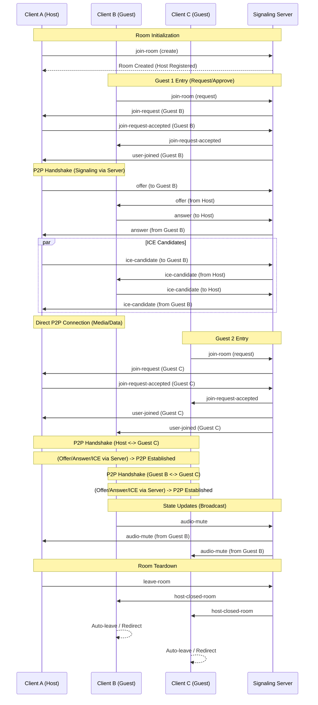

# ✨ Pockets

> A WebRTC playground for building stress-free, multi-device collaboration rooms.

Pockets is an experiment in making ad-hoc collaboration as frictionless as dropping files into a shared folder. It aims to let designers, engineers, or classrooms spin up a room, screen share, talk, chat, and exchange large assets directly over LAN or the public internet—all without managed infrastructure.

This README captures **what is being built**, **why specific subsystems exist**, and **how to run or extend the project**.

## Mission & Product Intent

- Enable multiple people across multiple machines to co-exist in the same “pocket” with audio/video, chat, and file transfer.
- Give participants agency over media devices without renegotiating entire peer connections.
- Keep rooms host-driven: guests ask for permission, hosts stay in control, and room state remains predictable even when someone rage-quits.
- Treat non-chat data as first-class citizens via a **pull-based, round-robin, multi-queue data channel** that scales better than naïve broadcast blobs.

## System Architecture

- **Frontend** – Next.js 15 App Router, React 19, Tailwind, Radix UI, Zustand stores, and Framer Motion finishings. The entire RTC lifecycle (media capture, peer negotiation, chat/file data channels, join-request UX) happens here.
- **Signaling Server** – Node.js WebSocket service (`server/`) that binds identity to a live socket session, authorizes room membership and signaling targets, reserves capacity atomically, and relays SDP/ICE payloads. Redis can store ephemeral room metadata but cannot restore live sessions.
- **Shared Contract** – `shared/` package keeps signaling envelopes, join-request payloads, and UserType enums in sync between client and server.
- **Monorepo** – pnpm workspaces manage three packages (`frontend`, `server`, `shared`) with shared dependencies and coordinated builds.

## Signaling & Message Flow

The following sequence diagram illustrates how clients (Host and Guests) interact with the Signaling Server to establish P2P connections and manage room state.



## Core Collaboration Features

### Media Surfaces & Device Orchestration

- `useMediaStore` + `MediaControl` expose toggles for mic, camera, speaker, chat panel, and graceful leave.
- `useSocket` wires these stores to WebRTC tracks, replacing video/audio senders on-the-fly whenever a user picks another device (no renegotiation needed).
- Local preview sits in PiP mode; remote participants render as a responsive grid.

### Request-Driven Room Entry

- Hosts create rooms (UUID backed) from the landing page. Guests can only enter by submitting the exact ID.
- Every guest join emits a `join-request` event. Hosts see a persistent card (`useJoinRequestStore`) with ACCEPT/REJECT actions that map to `join-request-accepted` or `join-request-rejected` messages.
- Guests stay in a waiting state (“Host approval pending…”) until they receive a decision; auto-join never occurs.

### Chat + File Management Micro-System

- Chat flows over a dedicated `chat` RTCDataChannel and remains in the current browser session in `useChatStore`; a reload clears chat history. The client deduplicates messages and keeps the latest 500 in timestamp order, with unread counts and attachment metadata.
- Sending files queues up to 10 assets (`useFileStore`), dedupes by name+size, and tags each attachment with the owner’s ID.
- Attachments are not auto-pushed. Instead, peers **request a download**, and the owner replays the relevant files through data channels (see below). This keeps bandwidth predictable and respects user intent.

## File Transfer Pipeline (Pull-Based, Round-Robin, Multi-Queue)

| Stage           | What happens                                                                                                                                                                                                                                                                 |
| --------------- | ---------------------------------------------------------------------------------------------------------------------------------------------------------------------------------------------------------------------------------------------------------------------------- |
| Queue sharding  | `useFile` slices up to `MAX_CHANNELS_FOR_DATA_TRANSMISSION` (5) queues and assigns files in a round-robin fashion. Each queue maps to its own RTCDataChannel (`transfer-{sessionId}-queue-{i}`) for better throughput.                                                                   |
| Metadata primer | Before chunks fly, the sender emits a `file-metadata` envelope (id, ownerId, size, MIME). Receivers cache this alongside the channel label.                                                                                                                                  |
| Chunk streaming | Files break into 30 KB slices (`CHUNK_SIZE`). The sender monitors `channel.bufferedAmount` to apply backpressure.                                                                                                                                  |
| Pull semantics  | Attachments render with contextual actions: `Open` (local), `Download` (already received), or `Request` (not yet downloaded). A request triggers `file-download-request`, the owner replies with `file-download-response`, and only the explicitly requested data transfers. |
| Persistence     | Completed transfers turn into object URLs and are cleaned up via `URL.revokeObjectURL` to prevent leaks.                                                                                                                                                                     |

## Host vs Guest Dynamics & Room Lifecycle

1. **Host creates room** – `useUserStore.initializeUserAsHost` issues a UUID and registers the user with the signaling server, claiming `room.hostId`.
2. **Guests request entry** – Guests can’t join unless a host socket is active. The server atomically reserves a pending slot and forwards the request to that host.
3. **Host decision** – Accepting moves the guest from the pending map into `room.users` and broadcasts `user-joined`. Rejecting simply removes the pending entry and notifies the guest with a reason.
4. **In-room behavior** – Up to 6 concurrent users (including host) can share media. All chat/file traffic stays peer-to-peer; the server only sees signaling metadata.
5. **Host exit** – When the host leaves, `notifyHostClosed` tears down the room, informs connected guests, and clears pending requests so nobody waits forever.

## Resilience & Edge Cases Already Handled

- **Single host per room** – Any second host attempting to reuse the ID receives `This room already has an active host` and is dropped.
- **Guest before host** – Guests are politely told to wait because the signaling layer refuses to spin up host-less rooms.
- **Capacity accounting** – Pending join requests count toward the 6-user limit to prevent over-admission once multiple requests are approved.
- **Socket disconnect** – Socket close, explicit leave, and heartbeat timeout use the same idempotent cleanup path. Host disconnect closes the room and informs active and pending guests.
- **ICE/RTC cleanup** – When sockets close or remote users leave, the client tears down peer connections, revokes object URLs, and resets Zustand stores to maintain a clean slate.
- **Device hot-swap** – The runtime listens to `navigator.mediaDevices.ondevicechange` events, auto-selects the next best device, and surfaces toasts if switching fails.
- **Broken transfers** – Each channel is isolated; a failed queue only affects the subset of files assigned to it, making retries cheaper.

## Tech Stack Snapshot

- **Next.js 15 / React 19** with App Router and server actions disabled (pure client-focused).
- **TypeScript everywhere** – shared envelopes, stores, hooks, server.
- **Tailwind v4 + Shadcn + Framer Motion** for interactivity.
- **Zustand** for persistent yet minimal state (user identity, media state, chat, files, join requests).
- **Node.js WebSocket server** powered by `ws`, with graceful shutdown handlers.
- **Redis** (optional) for single-instance room metadata and atomic admission operations; rooms are discarded on server startup because live sockets cannot be resumed.
- **esbuild** for fast production builds of server and shared packages.
- **pnpm workspaces** for monorepo package management.

## Repository Layout

```text
pockets/
├── frontend/
│   ├── app/                # Landing page, dynamic room route, global styles
│   ├── components/         # Custom UI (chat, media controls, animations)
│   ├── lib/
│   │   ├── hooks/          # socketHook, fileHook, mediaHook
│   │   ├── stores/         # Zustand stores for user/media/chat/file/join requests
│   │   └── utils/          # Audio analysis & file transfer logic
│   └── public/             # Static assets
├── server/
│   ├── src/
│   │   ├── repo/           # User and socket repositories
│   │   │   └── persistence/ # Redis and in-memory persistence layers
│   │   └── services/       # Room, socket, user, and request queue services
│   ├── util/               # Constants and types
│   ├── Dockerfile          # Production image, built from the workspace root
│   ├── docker-compose.yml  # Optional Redis for local development
│   └── index.ts            # WebSocket bootstrap + lifecycle hooks
├── shared/                 # Cross-runtime TypeScript definitions for signaling
├── Caddyfile               # Local HTTPS reverse proxy config (optional)
├── docker-compose.yml      # Production-like single-instance stack
├── pnpm-workspace.yaml     # Monorepo workspace configuration
└── LOCAL_DEVELOPMENT.md    # Full local setup guide
```

## Running the Project Locally

### Prerequisites

- Node.js 20+
- pnpm (`corepack enable pnpm`)
- Docker Compose (for the production-like full stack or optional Redis)
- Camera + microphone on each test device
- Machines on the same LAN if you want multi-device realism (see `LOCAL_DEVELOPMENT.md`)

### Installation & Bootstrap

```bash
git clone https://github.com/AatirNadim/pockets.git
cd pockets

# Install all dependencies (monorepo-wide)
pnpm install

# Copy environment files
cp server/.env.example server/.env.local
cp frontend/.env.example frontend/.env.local
```

### Running

```bash
# Optional: Start Redis for room metadata (not live session recovery)
cd server && docker compose up -d && cd ..

# Terminal 1 – signaling server (from project root)
pnpm dev:server

# Terminal 2 – Next.js frontend (from project root)
pnpm dev:frontend
```

The frontend runs on `http://localhost:3000` and the signaling server on `http://localhost:8080`.

Point every test device to `http://<host-ip>:3000` and make sure `NEXT_PUBLIC_SERVER_PATH` in `frontend/.env.local` resolves to that same IP and port 8080. HTTPS clients use `wss://`. A deeper LAN/deployment checklist (TLS, firewall, Caddy, network limits) lives in [`LOCAL_DEVELOPMENT.md`](LOCAL_DEVELOPMENT.md).

## Support and deployment limits

- Signaling is intended to run as one server instance. Redis does not route live WebSocket messages across replicas.
- Room membership is ephemeral; Redis room/user metadata is cleared when the server starts and cannot restore disconnected sockets.
- The room limit is six people including pending requests and the host. Current mesh topology needs browser/network measurements before increasing it.
- The default ICE list uses public STUN only. Networks that block direct ICE paths may need an authenticated TURN service.
- WebRTC transport is encrypted, but the product does not add identity verification or a separate application end-to-end security layer.
- Use HTTPS for camera and microphone access outside localhost, and configure `NEXT_PUBLIC_SERVER_PATH` to a browser-reachable signaling host.

Run the available quality checks from the repository root with `pnpm typecheck`, `pnpm lint`, `pnpm test`, and the build scripts.

## Testing Scenarios to Try

- **Multi-host defense** – Attempt to open the same room ID twice as host; the second should fail gracefully.
- **Join queue** – Join as several guests while the host is AFK; verify requests pile up and are drained when the host returns.
- **Device hot-swap** – Plug/unplug cameras or mics mid-call and switch via the dropdowns to confirm track replacement works.
- **File pull flow** – Attach files, send a chat message, request a download from another client, and observe the targeted transfer handshake.
- **Host leaving** – Close the host tab and watch guests auto-eject with “Host ended the room.”

## Contributing & Next Steps

- Documentation and UX improvements are tracked in GitHub issues.
- If you extend the signaling protocol or add TURN/STUN enhancements, update both `shared/types.ts` and this README.
- For multi-machine workflows or QA handoffs, share `LOCAL_DEVELOPMENT.md` alongside this README.
