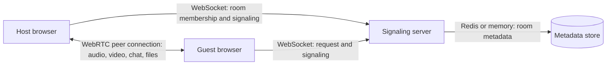

# Pockets

Pockets is a browser based collaboration prototype for small, temporary rooms. Participants can meet with audio/video, chat, and exchange files. Guests request entry and the room host approves each request.

## How a room works



The signaling service coordinates room membership and relays WebRTC offers, answers, and ICE candidates. After peers connect, audio, video, chat, and file bytes travel between browsers over WebRTC data/media channels. Redis, when configured, stores room metadata; it does not store files or restore live connections after a server restart. See [the architecture and feature flows](docs/README.md) for the full lifecycle and protocol overview.

## Repository guide

This is a pnpm workspace with three packages:

| Readme | Covers |
| --- | --- |
| [Architecture and feature flows](docs/README.md) | System boundaries, room admission, signaling, media, chat, file transfer, and operating limits |
| [Frontend](frontend/README.md) | Next.js app structure, room lifecycle, browser state, WebRTC, and frontend configuration |
| [Signaling server](server/README.md) | WebSocket protocol handling, room admission, persistence, lifecycle, and server configuration |
| [Shared protocol](shared/README.md) | Types and constants shared by the browser and signaling server |
| [Local development and deployment](LOCAL_DEVELOPMENT.md) | Installation, environment variables, HTTPS, Docker Compose, and checks |

## Quick start

Requirements: Node.js 20+, Corepack with pnpm 9.15.0, and a browser with camera/microphone support.

```bash
corepack enable pnpm
pnpm install --frozen-lockfile
cp server/.env.example server/.env.local
cp frontend/.env.example frontend/.env.local
pnpm dev:server
```

In another terminal, from the repository root:

```bash
pnpm dev:frontend
```

Open `http://localhost:3000`. The frontend defaults to signaling at `localhost:8080`. For LAN testing or deployment, set the browser reachable `NEXT_PUBLIC_SERVER_PATH` and use HTTPS so camera and microphone access is available. Follow [Local development and deployment](LOCAL_DEVELOPMENT.md) for details.

## Workspace commands

Run from the repository root:

| Command | Purpose |
| --- | --- |
| `pnpm dev:frontend` | Start Next.js in development mode |
| `pnpm dev:server` | Start the signaling service with watch mode |
| `pnpm typecheck` | Typecheck each workspace package |
| `pnpm lint` | Lint the frontend |
| `pnpm test` | Run signaling service tests |
| `pnpm build` | Build shared, server, and frontend packages |

## Product and deployment boundaries

- Rooms are temporary and support up to six participants, including pending guests.
- Media uses a full mesh of browser peer connections; connection count and network load grow as rooms get larger.
- The signaling server is designed as a single instance. Redis does not route WebSocket messages between replicas.
- ICE defaults to public STUN servers. Some networks require a separately operated TURN provider; Pockets can fetch short lived TURN credentials from a configured server side endpoint.
- WebRTC encrypts transport, but Pockets does not provide account identity verification or an additional application level end to end security layer.

For implementation details by package, start with the [architecture guide](docs/README.md), then follow its links to the frontend, server, and shared protocol READMEs.
