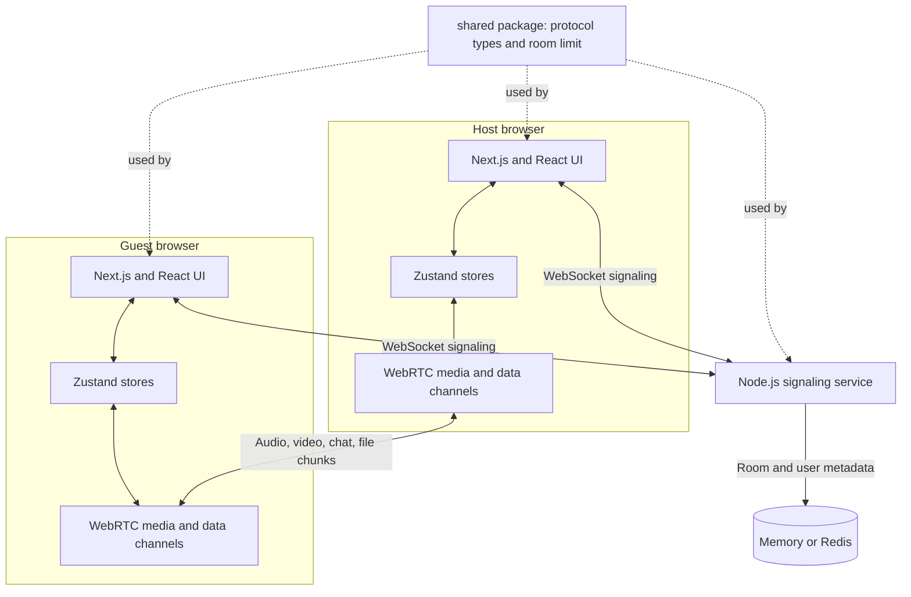
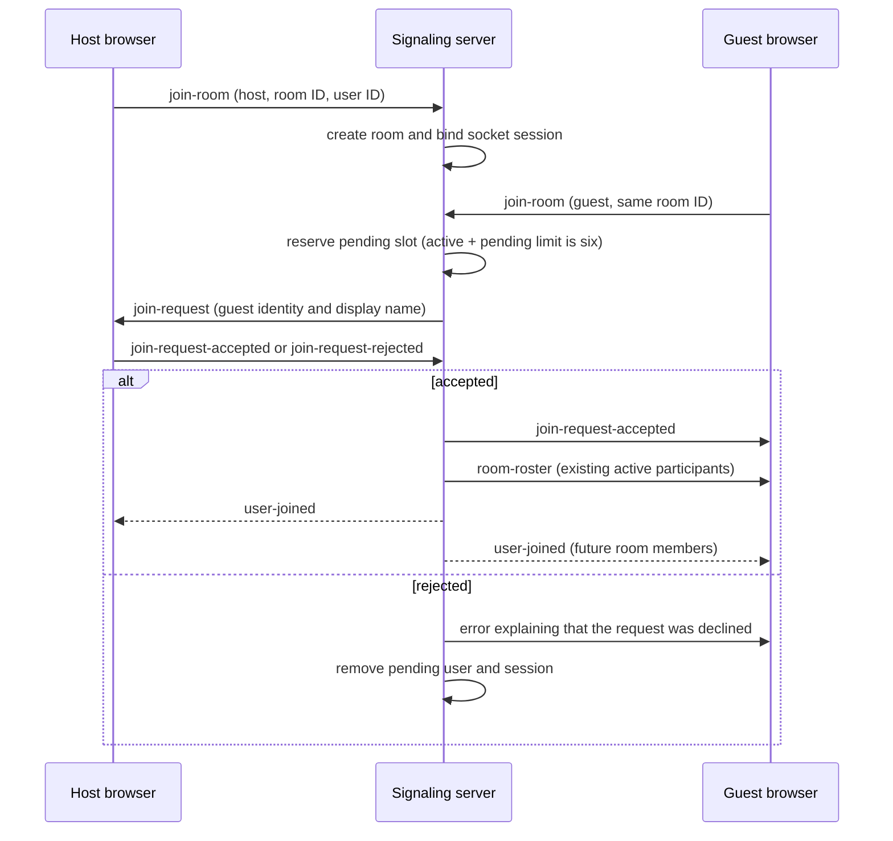
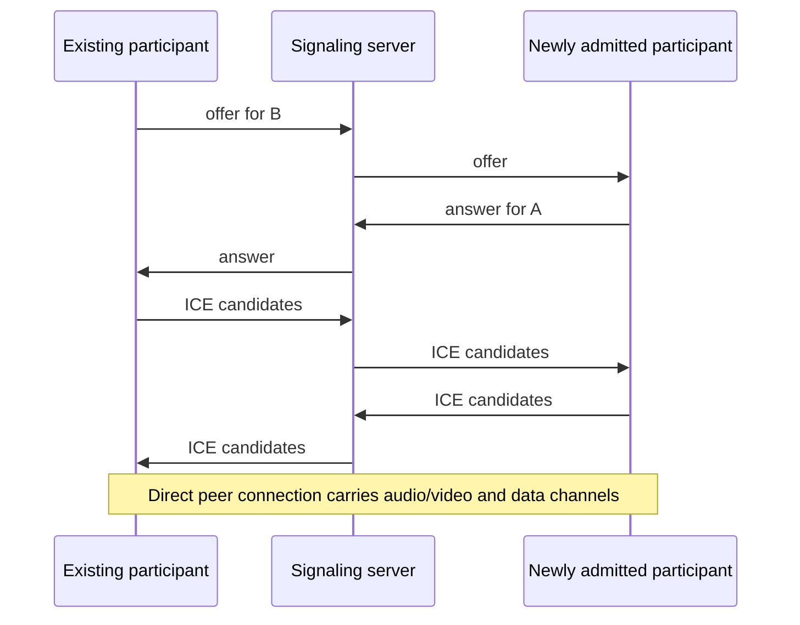
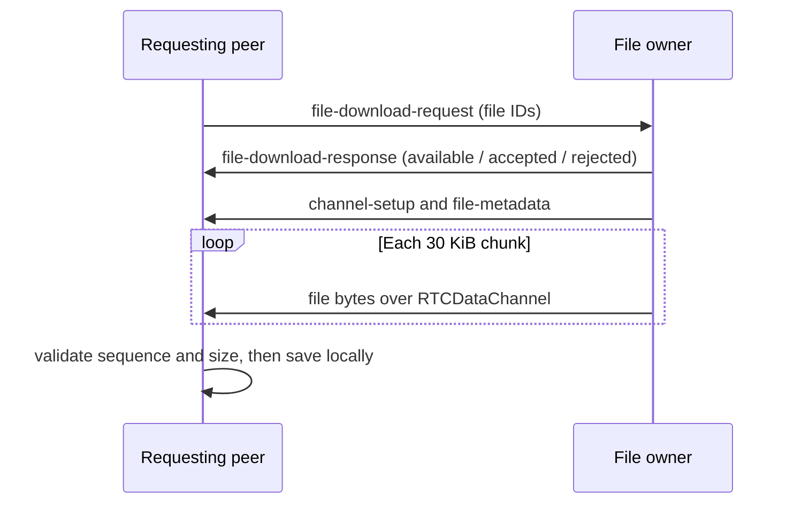

# Architecture and feature flows

This guide explains how Pockets moves from a landing page to an approved room, creates browser peer connections, and moves chat and files. It is the system level companion to the [root README](../README.md). For implementation by package, see [frontend](../frontend/README.md), [signaling server](../server/README.md), and [shared protocol](../shared/README.md). For setup, see [local development and deployment](../LOCAL_DEVELOPMENT.md).

## System boundaries

The browser owns media capture, peer connections, chat/file data channels, and most visible room state. The server owns room admission and relays negotiation messages. It does not proxy media, chat messages, or file bytes. Shared types keep the WebSocket envelopes and common limits aligned across the two runtimes.

## Room lifecycle

The host must have an active socket before a guest can request admission. A pending guest cannot send room messages until the host approves. Pending requests are included in the capacity check, alongside active participants, when the server reserves admission. Explicit leave, socket disconnect, and server shutdown invoke server cleanup; a host leaving closes the room for its other participants.

## Peer connection and media

When a participant is admitted, clients exchange the current roster and create a peer connection for each other active user. One client creates an SDP offer, the other returns an answer, and both exchange ICE candidates through the signaling service. Once ICE establishes a route, the browser-to-browser connection carries media tracks and data channels.

The client starts with public STUN servers. STUN can discover a route through many NATs but does not relay traffic. For stricter networks, configure `TURN_CREDENTIALS_URL` and optionally `TURN_CREDENTIALS_TOKEN` on the Next.js server; the endpoint must return short lived credentials in `{ "iceServers": [...] }` form. See [frontend configuration](../frontend/README.md#configuration) and [deployment setup](../LOCAL_DEVELOPMENT.md#environment-variables).

Each participant connects directly to every other participant. This full mesh is appropriate only for small rooms; the six-person cap is a product and resource boundary, not a guarantee that every device/network can support six simultaneous media peers.

## Chat and file exchange

Chat and file control messages share a peer data channel, not the signaling WebSocket. Chat is session scoped in browser state and is not persisted by the server. File attachments are advertised in chat but their bytes remain on the owner's device until requested or otherwise sent through the current transfer action.

The current transfer implementation uses 30 KiB chunks and up to five channels in a transfer session. Sender-side backpressure limits queued channel data; receiver-side validation checks declared sizes and chunk ordering. The browser controls where the received file is saved. These details are implementation limits, not a promise of a resumable or durable transfer.

### Download All

For a message with multiple attachments, **Download All** asks the browser to choose a destination folder. It then:

1. Separates files already available on this device from files owned by other participants.
2. Checks remote availability with each owner in parallel. An owner that does not respond within 12 seconds causes the bulk action to stop before saving or requesting files.
3. Saves available local files to the selected folder and groups available remote file requests by owner.
4. If files are unavailable, offers to send their owner a chat request to attach/re-share them. Files originally shared by the current user must be attached again locally.

The browser’s folder picker and write permissions apply. Files can be saved locally even if a different owner’s availability check fails; the operation is not a transaction across all participants.

### Expiry and cleanup

The owner keeps the queued file in a client-side catalog for ten minutes after the attachment is successfully sent in chat. A per-file timer removes expired entries from that catalog, and the transfer sender rechecks expiry before sending. Expiry does not delete the attachment reference from chat history, or any copy already downloaded by another participant. Expired entries show as unavailable; the owner must attach the file again for it to be shared again. Leaving or closing the room resets the local file store and cancels active transfers.

### Failure and retry behavior

- A download request is rejected or marked unavailable if the owner no longer has every requested file. The requester clears its pending progress state; the UI may offer an owner reupload request.
- A channel can fail because of a peer disconnect, a malformed or out-of-order chunk, a size mismatch, a local save/write error, a stalled receive, or a sender-side error. The client closes the affected transfer channel, clears its partial destination/progress, and reports the failure.
- Each sender session is isolated to one peer. A failed peer transfer does not cancel the other peer sessions in a broadcast send; the overall action reports if any peers failed.
- There is no automatic resume from a byte offset. After the failure state clears, the participant can request the file again while the owner’s copy remains available.
- Already completed files in a multi-file transfer can remain saved even if a later file or channel fails; a multi-file operation is not atomic.

## Persistence and lifecycle limits

- With `REDIS_URL` unset, room metadata uses in-memory persistence. With it set, Redis stores room/user metadata and room TTLs.
- Live sockets and their routing remain in one server process. Restarting the process ends sessions; Redis metadata cannot restore them or provide multi-instance socket routing.
- Chat history, attachment catalogs, and downloaded files are not server persisted.
- The default ICE list uses public STUN. TURN is an external service that operators configure.
- WebRTC encrypts transport between peers. The app does not authenticate participant identity or add a separate application end-to-end identity/security layer.

## Source map

| Concern | Main implementation |
| --- | --- |
| Landing and room UI | `frontend/app/home.tsx`, `frontend/app/room/[room]/` |
| Browser room connection and WebRTC | `frontend/lib/hooks/socketHook.ts`, `frontend/lib/hooks/mediaHook.ts` |
| Chat and file transfer | `frontend/lib/hooks/fileHook.ts`, `frontend/lib/utils/fileManagement/` |
| Server startup and health endpoint | `server/index.ts` |
| Admission, signaling, and cleanup | `server/src/services/socket.service.ts`, `server/src/services/room.service.ts` |
| Memory/Redis persistence | `server/src/repo/persistence/` |
| Shared signaling and data envelopes | `shared/src/types.ts`, `shared/src/constants.ts` |
