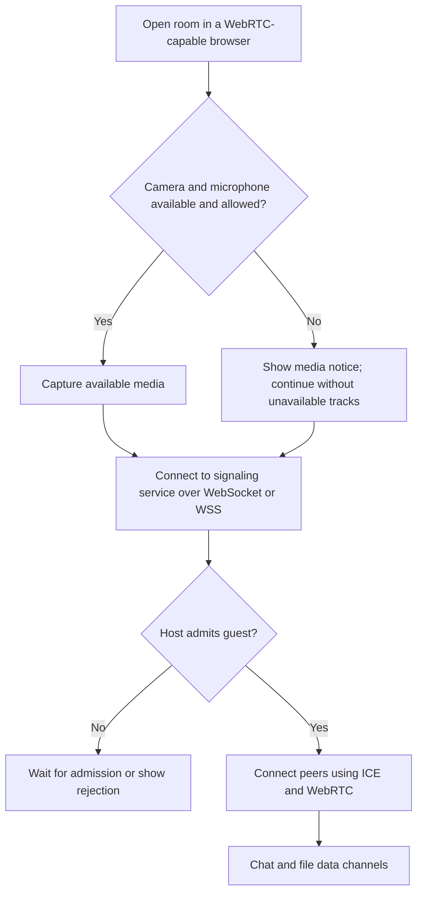

# Pockets frontend

Set `NEXT_PUBLIC_SITE_URL` to the canonical public origin for sitemap and social metadata. Vercel's deployment hostname is used when this is unset; local development falls back to `http://localhost:3000`.

The frontend is a Next.js 15 App Router application using React 19. It provides the landing and room experiences, obtains browser media, establishes WebRTC connections, and manages room chat and file transfers.

## Browser behavior and media permissions

The client needs browser support for WebRTC peer connections and data channels, plus WebSocket for signaling. Camera and microphone access is optional: the room UI reports denied permissions, missing devices, and unavailable media APIs, and the client can continue without available media. Users can change browser permissions and rejoin to enable those tracks. Deployed pages should use HTTPS and connect to the signaling service over WSS; a secure page alone cannot overcome restrictive NAT or firewall rules.



The app uses public STUN by default. Configure `TURN_CREDENTIALS_URL` on the Next.js server to fetch an `{ "iceServers": [...] }` response containing TURN configuration and short lived credentials; optionally set `TURN_CREDENTIALS_TOKEN` for server-to-server authentication. Pockets does not operate a TURN service. See the [deployment guide](../LOCAL_DEVELOPMENT.md) for network limitations and HTTPS proxy setup.

## Room features

- Guests request to join by room ID; the host approves or rejects them. Rooms allow up to six active and pending participants combined.
- Chat messages can go to everyone or to a selected set of connected peers. Selecting recipients sends directly to those peers' data channels; the signaling server does not receive the message.
- Keyboard help is available with `K` or `?`. On the landing page, `Enter` creates/joins the selected room, `N` creates a room, and `J` selects join. In a room, `M` toggles the microphone, `V` toggles the camera, `S` toggles speaker audio, `C` opens/closes chat and files, `I` copies the invite, and `L` opens the leave confirmation. `T` switches theme. Shortcuts pause while an editable control is focused.

The root layout generates the favicon, Apple touch icon, Open Graph card, and Twitter large-image card. Set `NEXT_PUBLIC_SITE_URL` to the canonical public site URL; Vercel's deployment hostname is used when unset, and local development falls back to `http://localhost:3000`. Room pages are excluded from indexing.

Start with the [root README](../README.md) for the workspace overview and quick start. See [architecture and feature flows](../docs/README.md) for the complete room and peer connection diagrams, [the server README](../server/README.md) for signaling behavior, and [local development and deployment](../LOCAL_DEVELOPMENT.md) for setup and HTTPS.

## Main paths

| Path | Responsibility |
| --- | --- |
| `app/home.tsx` | Create a room, enter a display name, or request to join by room ID |
| `app/room/[room]/page.tsx` | Compose the live room and connect room state to its UI |
| `app/room/[room]/` | Room header and participant video grid |
| `app/api/ice/route.ts` | Optional server-side fetch and validation of TURN/ICE credentials |
| `lib/hooks/socketHook.ts` | Signaling WebSocket, peer connections, chat channel handling, room events, cleanup |
| `lib/hooks/mediaHook.ts` | Camera/microphone access and device handling |
| `lib/hooks/fileHook.ts` | File download request handling and incoming/outgoing transfer coordination |
| `lib/utils/fileManagement/` | Transfer sessions, channel scheduling, upload session bookkeeping |
| `lib/stores/` | Zustand state for participants, media, chat, files, and join requests |
| `components/custom/` | Room controls, video tiles, join request UI, chat and file UI |

## Browser connection flow

1. The landing page initializes a host identity and room ID, or a guest identity and the supplied room ID.
2. The room client requests camera/microphone access, loads ICE configuration, then opens a WebSocket to the signaling service.
3. On socket open, it sends `join-room`. A guest waits for the host's admission decision before initializing peer links.
4. After admission, roster and `user-joined` events create peer connections. SDP and ICE signaling pass through the server; media tracks flow over WebRTC.
5. Room UI actions update local stores and tracks. Chat, file requests, and file bytes use peer data channels.
6. On leave or room closure, the client closes sockets/channels/peer connections, stops local tracks, and resets room-scoped state.

See the [room lifecycle](../docs/README.md#room-lifecycle) and [peer connection flow](../docs/README.md#peer-connection-and-media) diagrams for message-level details.

## Data channels and files

Chat is session scoped in Zustand state and limited to the latest 500 messages. File attachments are requested from the owner over a peer control channel, then streamed over negotiated transfer channels. The current implementation uses 30 KiB chunks, up to five sending channels, browser-side validation, and backpressure. Local file batch validation and limits live in `lib/utils/fileValidation.ts` and `lib/constants.ts`.

Files are not uploaded to the signaling service. A transfer is not a durable cloud upload and does not have server backed resume. The owner’s browser removes each shared file from its local catalog ten minutes after the attachment is posted to chat; the chat reference remains and becomes expired. Download All checks availability per owner, saves local files to a chosen folder, and requests remote files from their owners. The architecture guide covers [Download All, expiry, cleanup, and failure behavior](../docs/README.md#download-all).

Transfers report failures and clean up the affected channel and partial file destination/progress. Completed files from the same multi-file action may already have been saved. There is no automatic retry or resume; the recipient can request the file again while the owner still has it. Leaving the room resets local file state and cancels active transfers.

## Configuration

Copy `frontend/.env.example` to `frontend/.env.local` for development.

| Variable | Purpose |
| --- | --- |
| `NEXT_PUBLIC_SERVER_PATH` | Browser-reachable signaling hostname and port. The client selects `ws://` or `wss://` from the page protocol; a `ws://` or `wss://` prefix can override this. Defaults to `localhost:8080`. |
| `NEXT_PUBLIC_SITE_URL` | Canonical public site origin used for sitemap and social metadata. On Vercel, `VERCEL_URL` is used if this is unset. |
| `TURN_CREDENTIALS_URL` | Optional URL fetched by the Next.js server for short lived ICE/TURN credentials. It must return `{ "iceServers": [...] }`. |
| `TURN_CREDENTIALS_TOKEN` | Optional bearer token sent server-to-server to the credential endpoint. Keep it private; do not rename it with `NEXT_PUBLIC_`. |

The public STUN list is in `lib/constants.ts`. The `/api/ice` route returns an empty `iceServers` list when no credential endpoint is configured; the client then uses its built-in STUN list. More deployment detail is in [Local development and deployment](../LOCAL_DEVELOPMENT.md).

## Commands

Run at the repository root:

```bash
pnpm dev:frontend
pnpm --filter pockets-ui typecheck
pnpm lint
pnpm build:frontend
```
