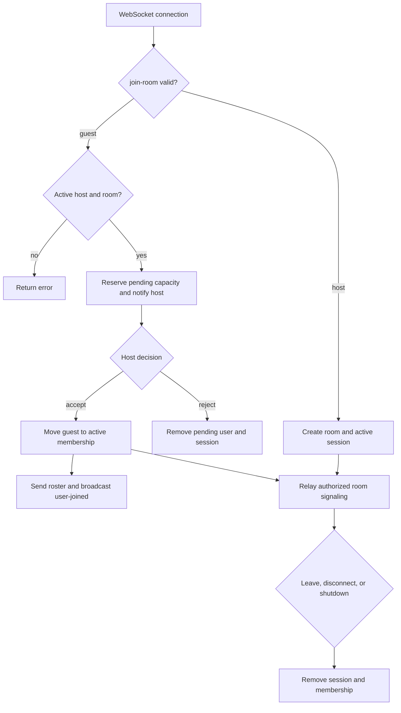

# Pockets signaling server

This package is a Node.js WebSocket signaling service with an HTTP health endpoint. It coordinates room membership and host approval, validates incoming signaling messages, and routes WebRTC offers, answers, and ICE candidates to active peers. It does not carry media, chat, or file bytes.

Start with the [root README](../README.md) for the workspace overview, and [architecture and feature flows](../docs/README.md) for the room lifecycle, peer connection, and data flow diagrams. The [frontend README](../frontend/README.md) describes the browser client; [local development and deployment](../LOCAL_DEVELOPMENT.md) covers setup and operations.

## Request lifecycle



Each WebSocket session is bound to a server-side user, room, role, and state. Incoming JSON is validated against supported message shapes, limited by WebSocket payload size and a per-socket message rate, then checked against that session before room operations are handled. Guest admission reserves a pending slot; pending guests are not active signaling participants until approval. The capacity is six total participants including the host and pending requests.

On successful admission, the guest receives an active room roster. Existing members receive a `user-joined` event and initiate peer negotiation. The server relays offer/answer/ICE messages, but the media and data paths are browser-to-browser. See [architecture: peer connection and media](../docs/README.md#peer-connection-and-media).

## Persistence and deployment model

`create-persistence.ts` selects in-memory persistence when `REDIS_URL` is unset and Redis metadata persistence when it is configured. Redis stores room/user metadata and room TTLs. WebSocket objects and user-to-socket routing remain in process memory, so a restart ends sessions and Redis does not enable multiple signaling replicas. Run one signaling instance for a room deployment.

The service responds to `GET /health` with JSON status and uses `PORT` (default `8080`) for both HTTP and WebSocket traffic. It has graceful shutdown handling and uses socket cleanup when a connection closes. Put the signaling endpoint behind a WebSocket capable TLS proxy when serving secure browser pages; the frontend must use a browser reachable host rather than an internal Compose hostname.

## Configuration

Copy `server/.env.example` to `server/.env.local` for development.

| Variable | Default | Purpose |
| --- | --- | --- |
| `PORT` | `8080` | HTTP and WebSocket listen port |
| `REDIS_URL` | unset | Optional Redis URL for room/user metadata; startup fails if configured Redis is unavailable |
| `ROOM_TTL_SECONDS` | `3600` | Redis room metadata expiry, refreshed while active rooms are maintained |

`dotenv` loads `.env.local` outside production. Do not commit local environment files or credentials. TURN credential configuration belongs to the Next.js frontend server; see [frontend configuration](../frontend/README.md#configuration).

## Source map

| Path | Responsibility |
| --- | --- |
| `index.ts` | HTTP/WebSocket bootstrap, payload cap, heartbeat, health route, graceful shutdown |
| `src/services/socket.service.ts` | Message validation, room joins, admission decisions, signaling routing, cleanup |
| `src/services/room.service.ts` | Room operations exposed to the socket service |
| `src/services/requestQueue.service.ts` | Pending guest queue operations |
| `src/services/user.service.ts` | User metadata operations |
| `src/repo/persistence/` | Persistence interface, memory and Redis implementations |
| `src/repo/user-socket.repo.ts` | Process-local socket routing |

## Commands

Run at the repository root:

```bash
pnpm dev:server
pnpm --filter pockets-signaling-server typecheck
pnpm test
pnpm build:server
```

The root `pnpm test` runs the signaling service test file. It does not exercise live browser media, NAT traversal, or end-to-end file transfers.
